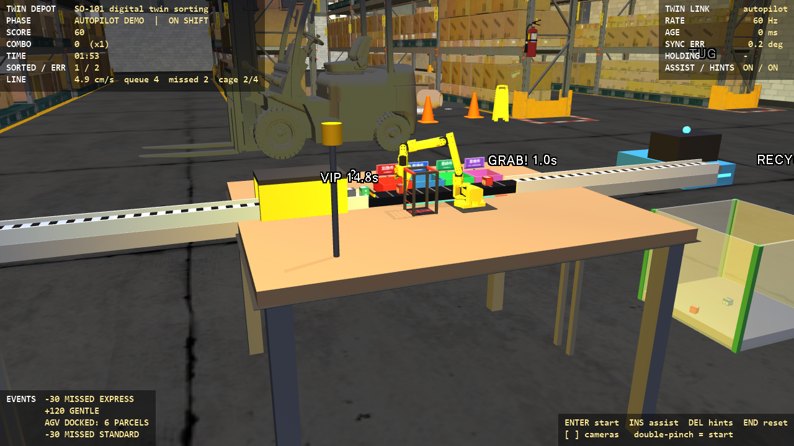
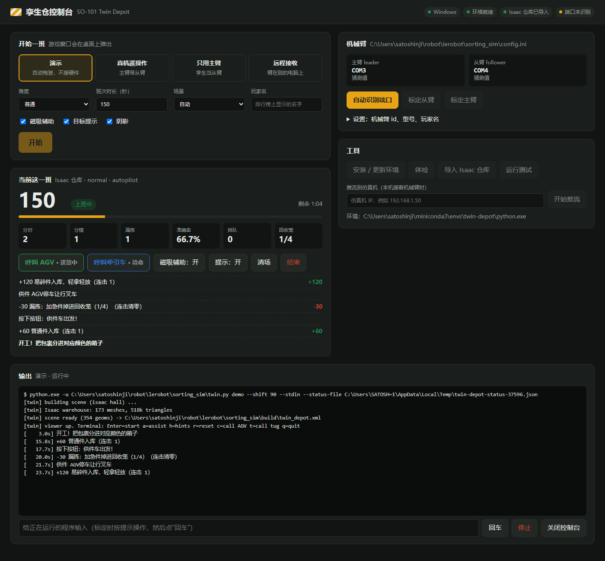
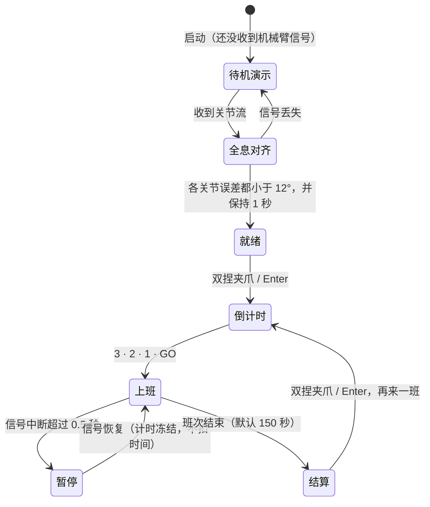
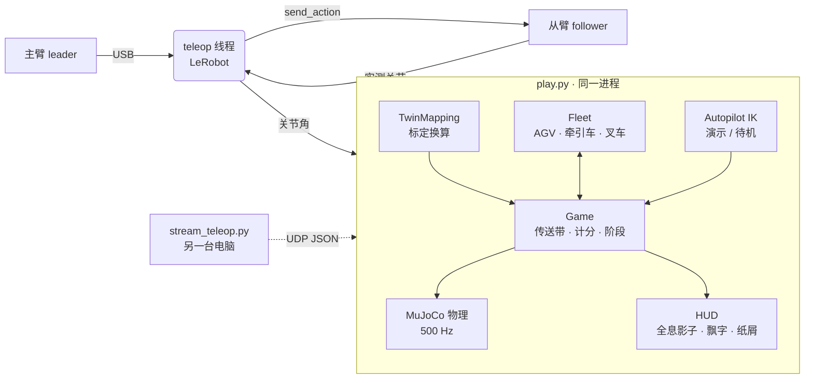

# 孪生仓 · SO-101 智能仓储数字孪生分拣（Twin Depot）

现实里你用手扳动 **SO-101 主臂（leader）**，**从臂（follower）**会同步动作。同时，MuJoCo 里的仓库工位上有一台从臂的**数字孪生**，它按从臂的**实测关节角**做出一模一样的动作：从一条**从面前流过、永不停下的长传送带**上把包裹边走边抓下来，越过皮带放进对面的四个颜色箱子。没抓到的包裹会一路流到尽头，掉进地上的回收笼。



- 场景背景是 **Isaac Lab / Isaac Sim 里的那个仓库**（`Simple_Warehouse/full_warehouse.usd`：货架通道、叉车、雪糕筒）。一次性从 NVIDIA 资产服务器下载并转换成 MuJoCo 网格，见[第 1.4 节](#isaac-sim-仓库场景)。没导入时自动用内置的夜班大厅。
- **一条完整的物流线，和车辆联动**（见[第 3 节](#3-规则与计分)）：
  - **供件 AGV** 去货架通道装一批包裹，装好后等你**按工作台上的绿色 CALL AGV 按钮**才出发。它开到皮带上游端，一件件卸到皮带上，车上看得到它运来的是什么。
  - **计量闸门**让排队的包裹一件一件放行。
  - 回收笼满了，**牵引车**来拉走、清空、再送回来；也可以按**蓝色 CALL TUG 按钮**提前叫它。拉走的这段时间里漏拣的包裹会直接摔在地上。
  - 两个按钮是工作台上真实的弹簧按钮，用机械臂（孪生的夹爪）按下去就会触发。
  - **叉车**在货架前巡逻，AGV 和牵引车要停车给它让行。
  - 车辆路线是根据场景几何自动规划的，会绕开货架和立柱。

- 孪生直接用 TheRobotStudio 官方的 `so101_new_calib.xml`（固定 commit 并校验 SHA256），零位与 LeRobot 的“新标定”一致，所以关节角可以直接对上。
- 抓取是**真实的物理接触**：两根手指各有一块摩擦指垫，夹得住才算夹住。默认开着“磁吸辅助”，新手也能玩，想要硬核可以加 `--no-assist`。
- 不接任何硬件也能玩：`--source demo` 会由自动驾驶（IK）上班给你看。

---

## 1. 快速开始

```bash
git clone https://github.com/satoshinji2992/lerobot_twin.git
```

然后**双击启动脚本**，浏览器里会打开控制台，之后的事都在网页上点：

| 系统 | 启动脚本 |
|---|---|
| Windows | 双击 `twin.bat` |
| macOS | 双击 `twin.command`（第一次可能要在“系统设置 → 隐私与安全性”里允许打开） |
| Linux | 运行 `./twin.sh` |



控制台（`http://127.0.0.1:8765`，只在本机开放）能做的事：

- **第一次使用**：点“安装 / 更新环境”，自动建环境、装 LeRobot 和 MuJoCo、导入 Isaac 仓库，进度显示在下方“输出”里。
- **开始一班**：选模式（演示 / 真机遥操作 / 只用主臂 / 远程接收），选难度、时长、场景、玩家名，点“开始”。游戏窗口照常在桌面上弹出。
- **实时成绩**：分数、倍率、剩余时间、分对 / 分错 / 漏拣、排队、回收笼、AGV 和牵引车状态，还有最近的事件。结算时显示评级和排行榜名次。
- **游戏内按钮**：开工、呼叫 AGV、呼叫牵引车、磁吸辅助、提示、清场、结束，和键盘、实体按钮效果一样。
- **自动识别端口**：点一下，按提示拔掉、插回主臂的 USB 线。网页自己检测串口变化，不用按任何键，识别完把端口和 USB 序列号存进 `config.ini`。
- **标定**：“标定从臂 / 标定主臂”。LeRobot 要你按回车的时候，点页面上的“回车”。
- **工具**：体检、导入 Isaac 仓库、运行测试、把本机的臂推流到另一台仿真机。

关掉启动脚本的窗口（或者点网页上的“关闭控制台”）就退出，正在运行的程序也会一起停掉。每次启动都会生成一个随机口令嵌在页面里，别的网站没法调用这个控制台。

不想用网页的话，命令行一样能用：

```bash
cd lerobot_twin
python twin.py setup      # 一次
python twin.py demo       # 不带命令 = 打开网页控制台；twin menu = 终端菜单
```

只需要 Python 3（用来跑启动器）。`setup` 会从 PyPI 装 `lerobot[feetech]>=0.4.4`，不需要 LeRobot 源码。要是把本仓库放在 LeRobot 源码目录里面（例如 `lerobot/sorting_sim/`），`setup` 会改成以可编辑方式安装那份源码。手动安装见 `requirements.txt`。

Windows、macOS、Linux 用的是**同一套命令**：`twin.py` 是一个只依赖 Python 标准库的启动器，`setup` 之外的命令会自动切换到 setup 建好的环境里运行，不需要手动 `conda activate`。

| 系统 | 怎么启动 |
|---|---|
| Windows | `twin demo`（不带参数打开网页控制台） |
| macOS / Linux | `./twin.sh demo`（不带参数打开网页控制台） |
| 任何系统 | `python twin.py demo`（任意 Python 3 都行） |

下文的 `twin xxx` 指上面任意一种写法。

| 命令 | 作用 |
|---|---|
| `twin setup` | 只需运行一次：建环境（有 conda 就建 `twin-depot` 环境，否则用 uv，再否则用自带 venv 建 `.venv`，都是 Python 3.12），安装 LeRobot（含飞特舵机 SDK）、MuJoCo、Pillow、pytest、usd-core，导入 Isaac 仓库（约 380 MB，下载一次），最后做一次无窗口自检。`--demo-only` 只装 MuJoCo，`--no-isaac` 跳过仓库下载 |
| `twin demo` | 自动驾驶演示，不需要硬件 |
| `twin ports` | **自动认端口**：按提示依次拔掉、插回主臂（和从臂），程序看哪个串口消失又出现，把端口名和驱动板的 **USB 序列号**一起写进 `config.ini`。之后换 USB 口、COM 号变了、重启电脑，都会按序列号自动找回对应的臂，不用重认。`twin ports --list` 只列出串口（带序列号） |
| `twin calibrate` | 用 LeRobot 依次标定从臂和主臂，每只臂只需做一次（`twin calibrate leader` 只标定主臂） |
| `twin real` | 标准玩法：主臂带动真实从臂，孪生镜像从臂的实测姿态 |
| `twin leader` | 只有主臂时使用，孪生就是“纯虚拟从臂” |
| `twin udp` / `twin stream` | 机械臂接在另一台电脑上时用，见下一节 |
| `twin config` | 查看设置；`twin config leader_id=alice player=小明` 修改设置 |
| `twin doctor` | 体检：Python、MuJoCo、能不能开 OpenGL 窗口、串口和权限、Isaac 资产 |
| `twin ui` | 网页控制台（不带命令时的默认）：`--port 9000` 换端口，`--no-browser` 不自动开浏览器 |
| `twin menu` | 终端里的数字菜单 |
| `twin import-isaac` | 重新导入 Isaac 仓库，可加 `--scene warehouse_multiple_shelves` 换别的仓库 |
| `twin tests` | 跑单元测试 |

第一次接真机的顺序是：`twin setup` → `twin ports` → `twin calibrate` → `twin real`。命令后面的参数会原样传给 `play.py`：

```bash
twin demo --difficulty hard
twin real --player 小明 --shift 90
twin demo --hall builtin            # 不用 Isaac 仓库，用内置大厅
twin demo --help                    # 所有游戏参数
```

没有序列号的廉价驱动板（或两块板序列号相同）只能按端口名记，换了 USB 口要重跑 `twin ports`，程序会提示。

`config.ini` 是每台电脑自己的设置（被 git 忽略），`play.py` 和 `stream_teleop.py` 也从这里读默认端口和 id，命令行参数优先。没运行过 `twin ports` 时会按系统猜一个端口并提示你：

| 系统 | 舵机板的串口名 | 注意 |
|---|---|---|
| Windows | `COM3`、`COM4` …… | 仓库放在 Windows 文件系统上（比如 `C:\Users\...\lerobot`），不要从 `\\wsl.localhost\...` 运行 |
| macOS | `/dev/tty.usbmodem…` | 弹窗需要 MuJoCo 的 `mjpython`，程序会自动切换过去，不用管。Mac 键盘没有 Insert / PageUp 等键，见[第 5 节](#5-操作) |
| Linux | `/dev/ttyACM0`、`/dev/ttyACM1` | 串口要有读写权限：`sudo usermod -aG dialout $USER` 后重新登录（Arch 是 `uucp` 组），`twin doctor` 会检查 |
| WSL | 同 Linux | 能跑，但 OpenGL 走 D3D12 转译很慢，默认关阴影、用内置大厅；USB 舵机板要先用 `usbipd attach --wsl` 转进来。能用原生 Windows / Linux 就别用 WSL |

- 标定文件存在 LeRobot 的默认位置（`~/.cache/huggingface/lerobot/calibration/`，Windows 是 `%USERPROFILE%\.cache\...`），`config.ini` 里的 id 必须和标定时用的一致。
- 不想用启动器也行：在任意装了 `mujoco numpy pillow` 的环境里 `python play.py --source demo`；真机还要 `pip install "lerobot[feetech]>=0.4.4"`。
- 首次运行会自动下载 SO-101 模型（约 16 MB）。

### 机械臂接在另一台电脑上

```bash
# 接臂的那台（克隆本仓库，twin setup、twin ports 照常做；端口和 id 从它的 config.ini 读）
twin stream --twin-host <仿真机IP>               # --no-follower：只推主臂

# 跑仿真的那台（可以是另一个系统，比如臂接 Linux 小主机、仿真跑在 Mac 上）
twin udp                                         # 默认监听 0.0.0.0:5566
```

网络上只传关节角（JSON over UDP）。仿真端只回传确认包和游戏事件，推流端终端会显示“+300 金色VIP入库”这类消息。仿真端**绝不会反过来控制真机**。Windows 防火墙第一次弹窗时，要允许 Python 访问专用网络；macOS 会问是否允许 Python 接受传入连接，选允许。没有硬件时，可以用 `stream_teleop.py --fake` 测试网络链路。

### Isaac Sim 仓库场景

Isaac Lab 自己不带场景文件，它运行时从 NVIDIA 的公开资产服务器（Nucleus，S3 上）加载，比如 `{ISAAC_NUCLEUS_DIR}/Environments/Simple_Warehouse/full_warehouse.usd`。`import_isaac_scene.py` 做的就是这件事，只做一次：

```bash
twin import-isaac          # twin setup 已经做过；会自动装 usd-core（只有导入需要，玩的时候不需要）
twin demo --hall isaac     # 默认 --hall auto：导入过就用（WSL 除外）
```

1. **下载**：从 USD 出发，递归抓取它引用的全部道具 USD、MDL 材质和贴图（约 2000 个文件，Isaac Sim 5.1 / Isaac Lab 2.3 的版本），保存在 `assets/isaac/raw/`，目录结构和服务器一致。
2. **转换**：把约 3500 个网格（68 万三角形）展平到世界坐标；把 MDL 材质参数“烘焙”成 MuJoCo 能用的贴图和颜色（反照率 × 色调、遮罩上色的货架和塑料箱、带透明度的地面标线）；再把外观相同的网格合并成一个 `.msh`（位置 + 法线 + UV）。最后得到 174 个网格、约 7 MB 贴图，放在 `assets/isaac/full_warehouse/`。
3. **摆放**：工位放在 5 排货架前的空地上，操作员视线正对货架通道，AGV 环线避开立柱。位置和朝向由 `layout.py` 的 `ISAAC_PLACEMENT` 决定，改了以后要重新导入。和工位重叠的道具会被清掉。

仓库只是**视觉背景**（没有碰撞体），工位、传送带和箱子还是自己的物理模型。其他几个 Isaac 仓库也能导入：`--scene warehouse | warehouse_multiple_shelves | warehouse_with_forklifts`。这些资产属于 NVIDIA（Isaac Sim 资产许可），只放在本地被 git 忽略的 `assets/` 目录里，不要再分发。

---

## 2. 交互流程



| 阶段 | 你在现实里做什么 | 孪生 / 屏幕上发生什么 |
|---|---|---|
| **待机演示** | 接线、上电、启动程序 | 自动驾驶像街机的 attract mode 一样慢慢分拣；HUD 显示 `waiting for arm signal` |
| **全息对齐** | 扳动主臂，让孪生臂和**青色全息影子**重合 | 孪生实时跟随从臂；影子是一个“抬臂、夹爪朝下”的就绪姿态；对齐后显示 `TWIN LINKED`。这一步既是开工仪式，也是在核对标定：真机摆在这个姿态时，孪生应该和影子完全重合 |
| **就绪** | **双捏夹爪**（快速夹紧、松开、再夹紧、松开） | 进入 3 秒倒计时。也可以按 Enter；手不用离开主臂就能开局 |
| **上班** | 在面前流过的皮带上抓起包裹，越过皮带放进对应的箱子 | 闸门放行越来越快、皮带越来越快；快离开抓取范围的包裹头顶出现 `GRAB! 1.2s`；AGV 送货、牵引车拉回收笼、叉车巡逻；连击倍率上升；VIP 倒计时 |
| **结算** | 看成绩，双捏夹爪再来一班 | 显示评级、准确率、最大连击，以及排行榜前 5（`data/leaderboard.json`） |

**真机和孪生的数据流**：主臂读数 → 从臂执行（经 LeRobot，开头有 2 秒软启动，从臂会滑到主臂姿态，而不是猛地跳过去）→ 从臂**实测**关节角 → 换算成 MJCF 关节角 → 孪生的位置伺服跟踪。孪生镜像的是从臂“实际做到了什么”，而不是主臂“想让它做什么”。这才是数字孪生。

---

## 3. 规则与计分

**流水线**：一条约 2.8 m 的直皮带，从机械臂正前方横穿工作台（从操作员看是由左向右），两头都伸到台外，架在支腿上：

| 区段 | 发生什么 |
|---|---|
| 上游端（台外左侧） | **供件 AGV** 停靠，升降平台和皮带一样高，把车上的包裹一件件卸下来 |
| 进料段（滚筒，快速 0.24 m/s） | 包裹排成一队，在**计量闸门**（台面上的黄黑小闸杆和隧道灯）前等待，你能提前看到接下来要来的几件 |
| 拣货段（慢速，正对机械臂） | 闸门每隔几秒放行一件。两侧台面有**绿色**标线（抓取区，约 40 cm 长）和**红色**标线（最后机会）。快离开抓取范围的包裹头顶会出现 `GRAB! 1.2s` |
| 出料段（滚筒，快速） | 没抓到的包裹被迅速送走 |
| 下游端（台外右侧） | 包裹从皮带尽头**掉进地上的回收笼**：算漏拣，扣 30 分（VIP 扣 80） |

四个分拣箱在**皮带对面**排成一排，所以每一件都要“抓起来、越过皮带、放下去”。扫描门挪到了机械臂左手边。

- 好抓的手法是**迎面接**：张开夹爪，横跨在皮带上（固定指贴着包裹的路径，活动指抬在上面），放在包裹前面等它滑进来，再合上并跟着走一小段。
- 在红色区段里抢下来是**极限救回**，加 25 分。
- **回收笼**装满 4 件后，**牵引车**会过来倒车挂钩，把笼子拖到货架通道里清空，再拖回来（约 20 秒）。笼子不在的时候信标灯红闪，这期间漏拣的包裹会直接**摔在地上，扣 50**。
- **供件 AGV** 每趟装 6 件，装好后停在货架通道里等呼叫。皮带上排队的包裹满了，它就停在码头等。路上遇到**叉车**会停车让行。

**两个呼叫按钮**在机械臂右手边（和扫描门相对），是带弹簧行程的蘑菇头按钮。把夹爪移到按钮上方往下按，按下超过 4 mm 就算一次，松开后才能再按。按钮的灯会提示该不该按：

| 按钮 | 作用 | 灯 |
|---|---|---|
| 绿色 **CALL AGV** | 让已经装好货的 AGV 立刻出发。如果它还在装货，装完马上走 | 亮 = 车已装好、在等你；快闪 = 排队区空了，赶紧按 |
| 蓝色 **CALL TUG** | 让牵引车**提前**拉走回收笼（笼子里至少有 1 件） | 亮 = 可以叫；快闪 = 笼子快满了 |

按钮背后的取舍：
- **CALL AGV**：AGV 从货架开过来要十几秒，等排队区快空了再叫，线就会断供。如果一直不按，排队区真的空了 AGV 也会自己出发，但会提示“下次早点按”，中间那段时间没有包裹可抓，分数就少了。
- **CALL TUG**：笼子满了才拉，往往正赶上忙的时候，漏拣的包裹就会摔在地上。在空闲时提前叫牵引车，可以避开这个时段。

按钮也可以用 `PageUp` / `PageDown` 键，或在终端输入 `c` / `t` 触发。在 MuJoCo 窗口里，还可以按住 Ctrl 加鼠标右键拖动按钮帽，直接把它按下去。演示模式下，自动驾驶会在不耽误抓件的空档里，自己伸手去按这两个按钮。
- 让行规则是严格的优先级：叉车 > 牵引车 > AGV。谁都不等比自己级别低的车，所以不会互相卡死。

**包裹**：

| 包裹 | 外观 | 应放入 | 基础分 | 特殊规则 |
|---|---|---|---|---|
| 加急件 | 红，“急” | 红箱 EXPRESS | 100 | |
| 普通件 | 蓝，牛皮胶带 | 蓝箱 STANDARD | 60 | |
| 易碎件 | 绿，▲▲ | 绿箱 FRAGILE | 120 | 必须**伸进箱子里再轻放**：落地速度超过 0.7 m/s（约 2.5 cm 自由落体）就算摔裂，扣 50 |
| 金色 VIP | 金色，头顶有倒计时 | 红箱 EXPRESS | 300 + 剩余秒数 × 10 | 25 秒内没送达就超时，扣 80；在场时信标灯会闪 |
| 神秘件 | 灰，“?” | 先拿到**扫描门**（红色激光帘）里停 0.8 秒，系统会揭晓真实去向 | 150 | 不扫描直接放进紫箱 QC 只得 30（稳妥但分少）；不扫描乱投就算分错 |

**倍率**：每连续分对 3 件，倍率 +1，最高 ×4。分错箱、掉落、摔裂、VIP 超时、漏拣都会让连击清零。VIP 的 25 秒倒计时从它通过计量闸门时开始算。

| 失误 | 扣分 |
|---|---|
| 分错箱 | −40 |
| 掉到地上 | −25 |
| 散落在台面超过 3 秒（自动回收） | −10 |
| 漏拣：包裹掉进回收笼 | −30（VIP −80） |
| 回收笼被拉走时漏拣：包裹摔在地上 | −50 |
| 极限救回：在红色区段抢下 | **+25** |

**评级**（按 150 秒班次计，班次时长不同时按比例缩放）：S ≥ 5000「传奇分拣官」、A ≥ 3000「金牌拣货员」、B ≥ 1500「熟练工」，其余是 C「实习生」。作为参照，不失手的自动驾驶（`--autopilot-miss 0`）在 `normal` 下跑 150 秒，能拿约 9000～11000 分，准确率 100%。演示模式默认让它“手慢” 18% 的包裹，好让回收笼和牵引车有活干。

难度用 `--difficulty chill|normal|hard` 调，控制闸门的放行间隔和拣货段速度。`normal` 难度从每 7.5 秒一件、4.5 cm/s，逐渐加快到每 5.5 秒一件、6 cm/s。班次长度用 `--shift 秒数` 设。

---

## 4. 作为数字孪生的细节

- **关节换算**（`twin_depot/twin.py`）：先用从臂自己的标定文件（`range_min/max`）把 LeRobot 的归一化读数还原成“相对量程中点的角度”，再换成弧度。不管用的是默认的 `RANGE_M100_100` 还是 `use_degrees=True`，结果都一样。夹爪 0~100% 线性映射到夹爪铰链角（0 = 闭合）。如果你的标定和官方模型有几度偏差，可以加 `--offsets "shoulder_lift=3,elbow_flex=-2"` 微调。
- **孪生遥测**（HUD 右上角）：数据源、刷新率、数据延迟（age），以及孪生和真机的最大关节误差（`SYNC ERR`）。
- **虚拟碰撞警告**：真机碰不到虚拟的箱子和传送带，但孪生会被它们挡住。当某个关节偏差超过 10° 并且已经停住不动时，HUD 会显示 `VIRTUAL CONTACT`，夹爪处出现红球，终端提示“孪生臂撞到虚拟物体了（真实臂感觉不到！）”。这正是数字孪生的价值：在虚拟世界里提前发现现实中还不存在的干涉。
- **舵机模型**：保留官方的 STS3215 力矩上限（±3.35 N·m），但把增益调成 kp=200、kv=1.5。原参数会把关节速度卡在约 1 rad/s，孪生跟不上真机。夹爪的力矩上限 ±1.5 N·m，对应 LeRobot 给夹爪设的 50% 力矩。
- **夹爪碰撞体**：官方网格的凸包会把两指之间的空间填满，没法真正夹东西，所以换成了从网格顶点量出来的指垫和掌心盒子。外观仍然用原网格。
- **自动驾驶怎么抓移动的包裹**：
  1. 先估算到达时间，在抓取区里选一个拦截点。
  2. 移过去，把张开的夹爪横跨在皮带上放下。
  3. 包裹滑到两指中间时，一边合爪一边逐帧跟随。
  4. 如果来晚了，就直接扣在正在经过的包裹上。

  然后斜着向上、朝箱子的方向提起来（贴近底座时竖直往上提会超出 5 自由度的工作空间），越过皮带，在箱子靠近机械臂的一侧轻放，最后沿原路退出，免得张开的夹爪卡在箱壁上。皮带对包裹的驱动还加了摩擦前馈，所以包裹的实际速度就是皮带速度，倒计时和拦截预测都是准的。
- **车辆**（`twin_depot/fleet.py`）：
  - 启动时把场景里所有静态几何（内置大厅的货架墙壁，或 Isaac 仓库的 68 万个三角形）在 0.03～2 m 的高度带内栅格化成 0.2 m 的占用图，再按车身尺寸膨胀。
  - 车辆用 A* 加拉直规划路线，原地转向后直行。停靠码头和挂钩最后一段是直线进出（挂笼时倒车）。
  - Isaac 仓库里那台叉车在导入时被单独导出成可移动的车辆，其余部分仍然是合并后的静态背景。
- **会话录制 / 回放**：`--record runs/xx.jsonl` 录下孪生的关节流，之后可以用 `--source replay --replay runs/xx.jsonl` 离线重放，不需要硬件。

---

## 5. 操作

| 方式 | 操作 |
|---|---|
| 机械臂手势 | **双捏夹爪**：开局 / 再来一班 · **按下工作台上的 CALL AGV / CALL TUG 按钮**：呼叫车辆 |
| 仿真窗口按键 | `Enter` 开始 · `Insert` 或 `Home` 磁吸辅助开关 · `Delete` 提示开关 · `End` 清场 · `PageUp` 呼叫 AGV · `PageDown` 呼叫牵引车 · `[` `]` 切换相机（操作员视角 / 腕部相机 `wrist_cam` / 俯视 / 大厅） |
| Mac 键盘 | `fn`+`←` 辅助（Home）· `fn`+`⌫` 提示（Delete）· `fn`+`→` 清场（End）· `fn`+`↑` 呼叫 AGV · `fn`+`↓` 呼叫牵引车 |
| 终端命令 | 回车 = 开始，`a` 辅助，`h` 提示，`r` 清场，`c` 呼叫 AGV，`t` 呼叫牵引车，`q` 退出 |

提示开着时，手里拿着包裹的话，对应的箱子会闪光，上方还会出现一个箭头；拿着神秘件时会提示你去扫描门。

---

## 6. 架构



```
lerobot_twin/
├── twin.py               跨平台启动器（只用标准库）：setup / demo / real / ports / calibrate / doctor ...
├── twin.bat · twin.command · twin.sh   启动脚本（Windows / macOS / Linux）：找到 Python，打开网页控制台
├── config.ini            本机设置：端口、id、玩家名（twin ports / twin config 生成，git 忽略）
├── play.py               游戏入口：python play.py --help
├── stream_teleop.py      远程推流端（机械臂接在别的电脑上时用）
├── import_isaac_scene.py 一次性导入 Isaac Sim 仓库（需要 usd-core）
├── twin_depot/
│   ├── layout.py         所有位置、尺寸、颜色、规则常数（唯一的配置来源）
│   ├── assets.py         下载并校验官方 SO-101 MJCF 和网格
│   ├── scene.py          生成 MJCF：仓库大厅、工位、传送带、分拣箱、扫描门、包裹池、AGV
│   ├── isaac_scene.py    Isaac 仓库：下载 USD 依赖、烘焙 MDL 材质、合并网格、生成 MJCF
│   ├── textures.py       用 Pillow 画中英双语标牌和包裹贴图
│   ├── twin.py           LeRobot 读数 ↔ 孪生关节角
│   ├── sources.py        数据源：real / leader / udp / replay
│   ├── game.py           游戏状态机、流水线（排队 / 闸门 / 回收笼）与计分
│   ├── autopilot.py      阻尼最小二乘 IK + 抓放流程（含移动目标的拦截与跟随）
│   ├── fleet.py          车辆：占用栅格 + A* 路线、供件 / 拉笼 / 巡逻任务、让行规则
│   ├── hud.py            叠加文字与 3D 特效
│   ├── webui.py · webui.html  网页控制台：本机 HTTP 服务、任务进程、端口向导、实时成绩
│   ├── system.py         各系统的差异：串口命名、config.ini、macOS 的 mjpython 切换、Linux 串口权限
│   └── app.py            主循环（viewer / headless）、自动认端口
└── tests/test_twin_depot.py
```

生成的场景会写到 `build/twin_depot.xml`，可以直接用 `python -m mujoco.viewer --mjcf build/twin_depot.xml` 打开查看。

---

## 7. 性能

实测（RTX 5090，含阴影）：**Windows 原生**，1920×1080 下内置大厅约 3.0 ms/帧，Isaac 仓库（314 个几何体、68 万三角形）约 3.6 ms/帧；场景编译不到 1 秒。WSL 下的 D3D12 转译光是内置大厅就要约 55 ms/帧。能用原生系统（Windows / Linux / macOS）就别用 WSL。

WSLg 的 OpenGL 走的是 Mesa→D3D12 转译，**每个几何体约 1 ms**。所以大厅里约 900 个装饰盒（货架、纸箱、标线）在生成时被合并成了按颜色分组的少数几个网格；停在地下“仓库池”里的包裹也不参与渲染。在 WSL 上程序会自动选 NVIDIA 独显（`MESA_D3D12_DEFAULT_ADAPTER_NAME=NVIDIA`），并默认关闭阴影（`--shadows` 可以打开）。原生 Linux 和 macOS 默认开阴影。在 WSL 上渲染不流畅的话，也可以试试 CPU 光栅化：`LIBGL_ALWAYS_SOFTWARE=1 GALLIUM_DRIVER=llvmpipe python play.py ...`。

macOS 上 MuJoCo 的交互窗口只能在 `mjpython` 下运行。`play.py` / `twin` 发现自己不在 `mjpython` 里时，会用同样的参数自动重启到 `mjpython`（它随 `pip install mujoco` 一起装好）。`--headless` 不需要。

---

## 8. 安全

- `--source real` 会让**真实从臂运动**，和 `lerobot-teleoperate` 一样。启动前清空从臂周围，第一次运行建议加 `--max-relative-target 10`，限制单步运动幅度。
- 连接时 LeRobot 可能会在终端里询问是否使用已有标定，按提示操作就行。
- 自动驾驶（demo / 待机演示）**只驱动孪生**，任何模式下都不会把仿真里的动作发回真机。

---

## 9. 测试

```bash
twin tests                                 # 或 python -m pytest tests -q；无窗口、无硬件，约 30 秒
```

测试覆盖：
- LeRobot 三种归一化模式的角度换算、标定文件解析。
- 磁吸焊接保持相对位姿。
- 自动驾驶完整跑一班，零失误。
- 包裹按皮带速度经过机械臂、不会停下，没抓到的会掉进回收笼并扣分。
- 计量闸门让包裹排队等待，并且一次只放行一件。
- 牵引车把满的回收笼拉走、清空，再放回原位。
- 物理按下 CALL AGV 按钮会派出装好货的 AGV；回收笼为空时 CALL TUG 不会派车，有货时会；自动驾驶会自己按按钮。
- 路线规划会绕开工作台和长皮带。
- Isaac 仓库能编译成纯视觉背景（没导入时跳过）。
- 双捏手势开局。
- 网页控制台：口令校验、一次只跑一个任务、跑完一班能读到实时成绩和输出。
- 跨平台：Windows / macOS / Linux 各自的串口猜测、`config.ini` 读写与默认值、macOS 自动切换到 `mjpython`、启动器在环境里运行命令。

---

## 10. 可以继续玩的方向

- **在孪生里采集示教数据**：把每次成功分拣录成 LeRobotDataset（孪生腕部相机 + 关节），用来训练 ACT / SmolVLA，再部署回真机。这就是 sim-to-real。
- **对接 ROS 2 / Gazebo**：UDP 关节流协议很简单，`stream_teleop.py` 发的 JSON 可以原样转发给其他仿真器或 ros2 节点。
- **混合现实桌垫**：按 `layout.py` 的坐标打印一张 1:1 桌垫，贴在从臂底座周围，真机夹爪就能“指”到虚拟箱子的位置。
